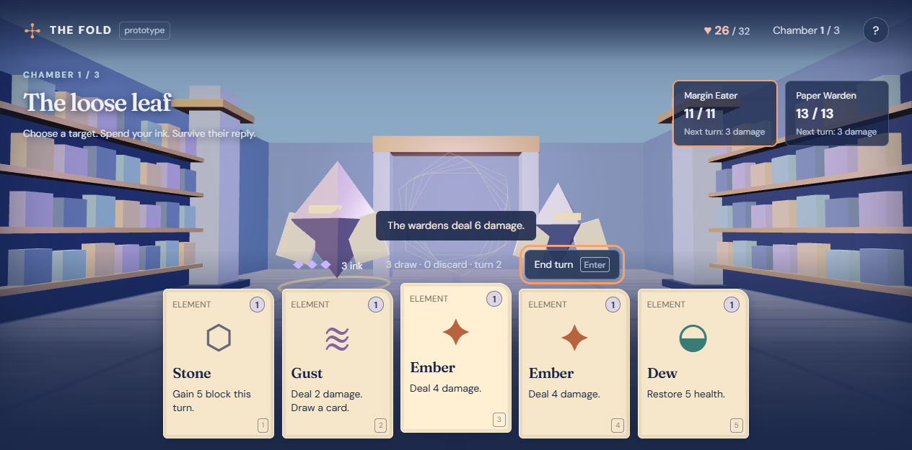

# The Fold

A first-person card-crafting roguelike **prototype**. Walk through three library chambers, fight their wardens with a hand of spell cards, and permanently merge cards between encounters.

This is a short vertical slice for testing the combat/crafting loop, not the longer campaign yet. It has no accounts, paid services, analytics, multiplayer, or persistence. Refreshing starts over.



## Run

Requires Node.js 22 LTS and a desktop browser with WebGL.

```sh
cd games/card-roguelike
npm ci
npm run dev
```

Open the URL printed by Vite. For a repeatable run, append `?seed=42`.

```sh
npm run check
npm test
npm run build
```

The static output is `dist/`. Assets use relative URLs by default, so it can be served at `/`, `/games/the-fold/`, or another subpath. Set `GAME_BASE` at build time only if an explicit base is needed. No custom domain or DNS was changed by this prototype.

## Controls

- Explore: WASD to walk. Click the scene to capture the mouse and look around. Esc releases it. Arrow keys can also move/turn without pointer lock.
- Forge: F or the visible forge button between encounters. Pick two copies, inspect the preview, then confirm. Both inputs are permanently consumed.
- Fight: movement pauses when entering an encounter. Click an enemy, or Q/E to cycle targets. Click cards or press 1–5. Enter ends the turn and refills your three ink. Enemy damage is shown before you commit.
- Finish: clear all three chambers. Win/death screens can immediately restart the run.

Mouse and keyboard are supported. The layout shrinks to narrow screens, but touch movement is **not implemented**.

## What is reused

The first-person controller is adapted from the MIT-licensed **official Three.js FPS example**, pinned to r181. It uses Three.js's existing Octree and Capsule collision modules. This repository retains the original source and license under `vendor/upstream/`. Card rules, geometry, encounter loop, and interface are original additions built on that foundation.

See [RESEARCH.md](RESEARCH.md), [THIRD_PARTY.md](THIRD_PARTY.md), and [DESIGN.md](DESIGN.md) for sources and decisions.

## Good next contributions

- More interesting enemy intentions and a fuller draw/discard interface.
- A second tier of merge recipes; effects/data live in `src/rules.mjs`.
- Distinct room layouts and a procedural route, retaining the Octree collision foundation.
- Sound, card animations, and stronger hit feedback.
- Touch controls and screen-reader alternatives to spatial exploration.
- Longer runs and saved progress after the short loop feels good.

Keep gameplay rules in `src/rules.mjs` and cover regressions with Node's test runner. The game currently reuses the same room shell for all three encounters. Each run shuffles hands and rewards; it does not yet generate a dungeon map.

## Verification

The initial desktop Chrome check covered walking into encounters, selecting/casting cards, merging inputs and checking the reduced deck count, all three chamber clears, loot selection, winning, death, and restart. Enter on a focused end-turn button advanced exactly one turn. Eight Node tests cover crafting ownership, invalid selections, casting resources/targets, area damage, block/death, draw recycling, and reward progression. Narrow-screen layout is separate from touch-control support.
